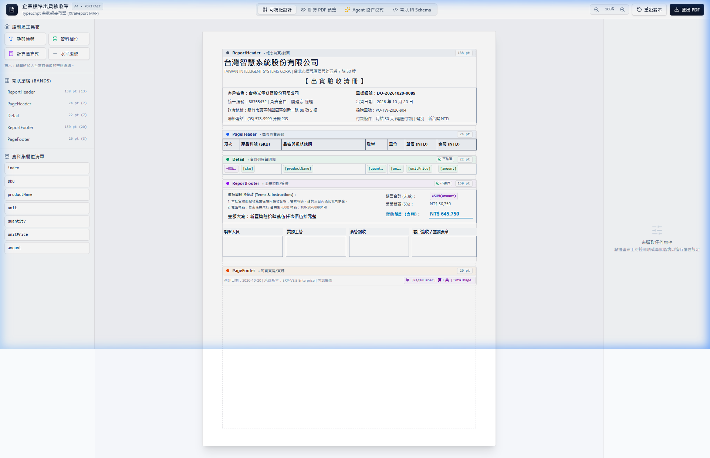
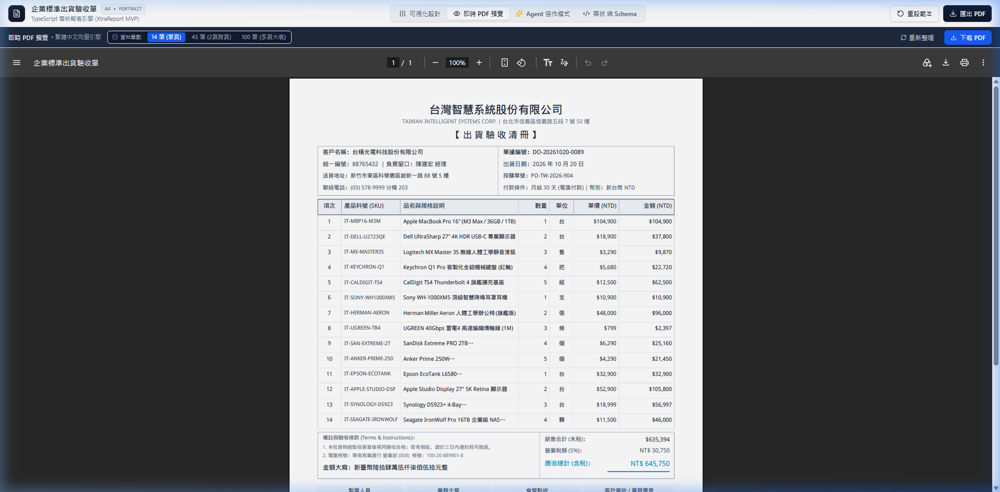
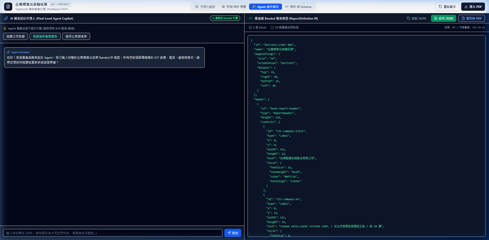
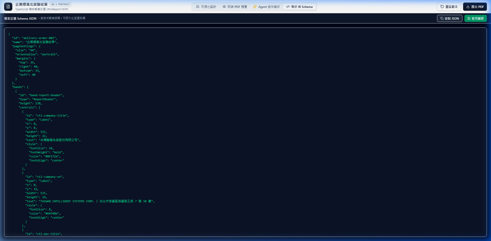

# TypeScript 輕量級 XtraReport 報表引擎 (MVP)

以 **`@react-pdf/renderer`** 為底層向量排版與輸出引擎，打造一套具備 **像素級帶狀模型（Pixel-Level Banded Architecture）**、**可視化設計器（Designer）** 與 **即時向量 PDF 預覽器（Viewer）** 的 Web 原生現代企業級報表系統。

風格全面採用 **shadcn/ui** 現代簡潔灰階調色，內建本地完整繁體中文字型支援（Noto Sans TC），並提供專屬 **AI Agent 像素級 MCP 伺服器**。

---

## 📸 介面展示 (Screenshots)

### 1. 可視化設計器 (Visual Designer)
採用正統 Band 帶狀標題條（Band Strip）架構，控制項座標嚴格隔離，支援滑鼠拖曳定位、Band 高度拉伸、以及右側即時屬性檢查器（Property Grid）。



---

### 2. 即時 PDF 向量預覽器 (PDF Live Preview)
直接於瀏覽器內無伺服器（Serverless）即時算繪企業級高水準出貨單：
- 完整包含**多欄客戶資訊卡**（左側統編、地址、聯絡人；右側單號、採購單、月結條件）。
- **精密封閉表格**：垂直貫穿格線、灰底粗框表頭、明細列資料自動對齊。
- **會計結算卡**：交易注意事項、中文大寫金額（`新臺幣陸拾肆萬伍仟柒佰伍拾元整`）、未稅小計、5% 營業稅與雙底線含稅總計。
- **四格核決印章矩陣**：製單人員、業務主管、倉管點收、客戶簽收蓋章。
- 支援多頁跨頁、表頭自動重複（PageHeader）、動態原生頁碼（`第 1 頁，共 2 頁`）以及全表統計總計（`=SUM(amount)`）。



---

### 3. Agent 協作模式 (Pixel-Level Agent Copilot)
專為 AI Agent 設計的像素級 Banded IR 模型。不同於過度簡化死板的 Template 封裝，系統賦予 Agent 完整控制像素座標（`x`, `y`, `width`, `height`）、邊框粗細與文字對齊的能力，讓 Agent 能排版出 100% 貼近真實人類 ERP / 會計日常使用的複雜企業單據。



---

### 4. 宣告式 JSON Schema 檢視與即時編輯 (Schema Editor)
整份報表採用純 JSON 宣告式結構定義，可雙向編輯並立即套用回設計器，極易持久化儲存於後端資料庫或進行版本控制。



---

## ✨ 核心特色 (Key Features)

- **正統像素級帶狀架構 (Pixel-Level Banded Architecture)**：
  - `ReportHeader`：報表首頁封面、公司抬頭、左右客戶與單據卡片（僅第一頁出現一次）。
  - `PageHeader`：每頁固定重複的表格標題列（跨頁自動重複）。
  - `Detail`：依傳入之資料集逐筆展開資料列範本，具備垂直格線貫穿。
  - `ReportFooter`：全表會計結算（大寫金額、稅額、雙底線總計）與企業四格簽核矩陣（僅最末頁出現一次）。
  - `PageFooter`：固定於每頁底部的頁尾、列印資訊與動態頁碼。
- **全面可視化設計體驗 (Interactive Canvas & Shortcuts)**：
  - **8 向拖拉縮放**：物件選取即顯示高對比實心藍色錨點，支援 8 向縮放並即時顯示尺寸徽章（線段智慧鎖定單軸）。
  - **HTML5 拖拉放置 (Drag & Drop)**：可直接將工具箱中的控制項或資料欄位拖入畫布任意 Band 的精確位置。
  - **完整鍵盤快捷鍵**：
    - `Delete` / `Backspace`：一鍵刪除選取的控制項。
    - `↑` `↓` `←` `→`：方向鍵精細微調 1pt（按住 `Shift` 加速 5pt）。
    - `Escape`：取消選取，切換回全域報表版面設定。
    - `Ctrl + 滑鼠滾輪`：畫布 50% ~ 200% 平滑縮放。
- **資料集與欄位總管 (Dataset & Field List)**：
  - 側邊欄抽屜式「資料集欄位總管」，自動自資料集萃取可用欄位（`index`、`sku`、`productName`、`category`、`unit`、`quantity`、`unitPrice`、`amount`）。
  - 支援關鍵字搜尋欄位、一鍵新增或拖放至明細列。
  - 支援透過 `useReportStore.getState().setData(apiData)` 動態注入後端 API 真實資料。
- **可擴充外掛控制項系統 (Plugin Registry)**：
  - 內建 9 大開箱即用控制項：`Label` (文字標籤)、`Field` (資料欄位)、`Expression` (計算表達式)、`Line` (線段分隔)、`Barcode` (條碼)、`QRCode` (二維碼)、`Image` (圖片)、`CheckBox` (核取方塊)、`Panel` (邊框容器)。
- **真實企業出貨單設計標準**：
  - 徹底告別過度簡化的玩具樣式，涵蓋真實商務必備之統編、交貨地址、匯款帳號、法律備註、中文大寫金額與核決印章格。
- **AI Agent 原生像素級 MCP 工具組 (Agent-Native MCP Server)**：
  - 支援 Model Context Protocol (MCP) 標準，提供 13 個精準原子工具（包含幾何排版健檢、可用欄位感知、批次更新、頁面微調與雙向熱重載），讓 Agent 具備像素級排版與感知能力。
- **純前端直出 PDF (Client-side Rendering)**：
  - 採用 `@react-pdf/renderer`，無需常駐 Node.js / Puppeteer 伺服器，大幅降低伺服器負載與維運成本。
- **中文字型零亂碼支援**：
  - 內建標準繁體中文字型（Noto Sans TC），徹底解決 PDF 中文亂碼與問號問題。
- **運算式與格式化引擎**：
  - 支援合計運算 `=SUM(field)`、資料列序號 `=ROW_INDEX`。
  - 支援貨幣格式化（`C0`、`C2`）、千分位數值（`N0`）、日期格式化。
- **多頁與長表驗證**：
  - 內建 14 筆（單頁）、45 筆（2頁跨頁）、100 筆（4~5頁大表）快速切換測試。

---

## 🛠️ 技術選型 (Tech Stack)

| 模組 | 選型 | 說明 |
| :--- | :--- | :--- |
| **底層 PDF 引擎** | `@react-pdf/renderer` | 提供 PDF 向量繪製、Flexbox 自動流式排版、分頁斷頁能力 |
| **前端框架** | `React 19` + `TypeScript` + `Vite 8` | 極速模組熱重載 (HMR) 與型別安全 |
| **UI 設計系統** | `shadcn/ui` + `Tailwind CSS v4` | 現代簡約的灰階質感介面與圖示庫（`lucide-react`） |
| **狀態管理** | `zustand` | 輕量、反應迅速的像素級報表定義與畫布狀態管理 |
| **Agent 協作協定** | `@modelcontextprotocol/sdk` | 支援 Stdio 傳輸之標準 MCP Server |

---

## 🚀 快速開始 (Getting Started)

### 1. 安裝依賴

```bash
npm install
```

### 2. 啟動本機開發伺服器

```bash
npm run dev
```

開啟瀏覽器前往 [http://localhost:5173/](http://localhost:5173/) 即可開始體驗！

### 3. 啟動 MCP 伺服器 (供 Claude Desktop / Cursor / Antigravity 調用)

```bash
npm run mcp
```

### 4. 建置生產版本

```bash
npm run build
```

---

## 🤖 AI Agent 整合：MCP 伺服器 (Model Context Protocol)

本專案內建標準的 **MCP 伺服器**，任何支援 MCP 的 AI Agent（如 Claude Desktop、Cursor、Antigravity Agent、Cline 等）皆可直接透過工具調用（Tool Calling）精準操控整份報表！

### 1. 提供的 13 大像素級 MCP 工具

| MCP 工具名稱 | 說明 |
| :--- | :--- |
| `get_report_layout` | 讀取當前整份報表規格（包含可繪寬度、所有 Bands 與控制項精確座標、樣式） |
| `get_available_data_fields` | 【全新】取得報表可供綁定的資料集欄位清單（明細欄位型別、範例值、系統聚合函式及格式化建議），方便精準綁定 `fieldName` 或撰寫計算公式 |
| `add_control` | 在指定 Band 新增精確座標的控制項（支援 `Label`、`Field`、`Expression`、`Line`、`Image`、`Barcode`、`QRCode`、`CheckBox`、`Panel` 9 大型別） |
| `update_control` | 修改特定控制項之座標 (x, y)、尺寸 (width, height)、文字內容或樣式屬性 |
| `batch_update_controls` | 【全新】一次性批次更新多個控制項的屬性與樣式（適合整組欄位改字體、微調位置或套用統一色彩，大幅節省操作輪次） |
| `delete_control` | 從指定 Band 中刪除特定控制項 |
| `set_band_height` | 調整指定 Band 的物理高度（pt） |
| `set_band_controls` | 批次置換某個 Band 的全部控制項（適合 Agent 一次排好客戶資訊卡或簽核矩陣） |
| `update_page_settings` | 【全新】更新報表全域頁面設定（紙張尺寸 A4/Letter、方向 portrait/landscape、上下左右邊界 margins），自動重新計算可繪寬度 |
| `reset_report_layout` | 【全新】一鍵重置報表版面結構回復為企業標準出貨單範本（若排版錯亂時可安全還原） |
| `set_full_report` | 直接替換整份 ReportDefinition（適合 Agent 一次性產生整張新單據） |
| `inspect_and_preview_layout` | 【Agent 排版感知核心】秒級幾何健檢與視覺快照。自動偵測溢出破版、文字碰撞、表格欄位垂直對齊度，並同步輸出首頁 SVG 向量圖與實體 PDF 檔案 |
| `export_pdf` | 使用當前像素架構直接算繪高解析 PDF 輸出至本機磁碟供檢驗 |

---

### 2. Client 端設定範例 (Cursor / Claude Desktop / Antigravity)

在您的 MCP 設定檔（例如 Claude Desktop 的 `%APPDATA%\Claude\claude_desktop_config.json`、Cursor 的 `%USERPROFILE%\.cursor\mcp.json`、或 Antigravity 的 `~/.gemini/config/mcp_config.json`）中加入以下內容：

#### Windows 環境最穩定配置（推薦）：
```json
{
  "mcpServers": {
    "report-engine": {
      "command": "C:\\Program Files\\nodejs\\npx.cmd",
      "args": [
        "-y",
        "tsx",
        "d:/Source/Private/report_engine_mvp/src/mcp/index.ts"
      ],
      "cwd": "d:/Source/Private/report_engine_mvp"
    }
  }
}
```

> [!TIP]
> 1. 若 Node.js 安裝在非預設路徑，也可將 `command` 設為 `"cmd.exe"`，並將 `args` 第一個參數改為 `"/c"`。
> 2. 路徑中的斜線請使用正斜線 `/` 或轉義雙反斜線 `\\`，避免 JSON 解析錯誤。

---

### 3. 🔄 前端即時雙向熱更新 (Bidirectional Live Sync)

本專案內建 Vite 即時檔案同步中介層與狀態防抖引擎：
- **外部 Agent ➔ 前端畫布**：瀏覽器介面每 1.5 秒自動監聽磁碟上的 `current_report_layout.json`。當外部 AI Agent 透過 MCP 執行修改時，**瀏覽器無需手動刷新，1 秒內自動熱重載最新版面與即時 PDF 預覽**！
- **前端畫布 ➔ 外部 Agent**：當使用者在可視化設計器中手動拖曳控制項、微調尺寸或修改樣式時，系統透過 **500ms 防抖自動寫回磁碟**，Agent 呼叫 `get_report_layout` 即可立刻讀取到使用者的最新調整，達成 **100% 雙向協同**！
- **連線指示燈**：頂部導航列常駐 `🟢 雙向已同步 🔄` 狀態膠囊，寫入與同步狀態一目了然。

---

### 4. 💬 AI Agent 實測 Prompt 範例

連線後，您可以直接對 Agent 發送以下指令進行測試：

- **版面健檢與感知**：
  > 「請幫我調用 report-engine 工具，檢查目前出貨單是否有任何溢出破版或欄位未對齊，並回報目前的區塊輪廓圖。」
- **精確修改單一資訊**：
  > 「請幫我把出貨單中的客戶聯絡電話分機加上 204。」
- **表頭風格批次置換**：
  > 「請幫我把表格表頭底色切換為商務深藍 (#1e3a8a)，文字改為純白粗體，完成後呼叫 inspect_and_preview_layout 驗證。」

