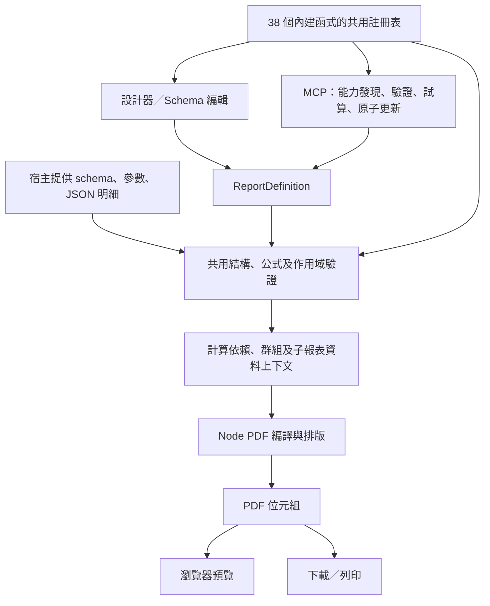

# Report Engine MVP 實作狀態與後續計畫

更新日期：2026-10-24。

目前交付獨立的 TypeScript 報表元件 MVP，包含設計器、資料繫結與公式、Node PDF 編譯、預覽／下載，以及 MCP。Haneinfo 是未來可能的宿主，本輪沒有整合工作。

本文件記錄目前架構與交付狀態。需求訪談見 [公式引擎 v1 設計紀錄](docs/formula-engine-v1.md)，實際契約與操作方式見 [使用方式](docs/formula-engine-usage.md)，驗證與限制見 [CODE_REVIEW.md](CODE_REVIEW.md)。

## 目前架構



範本使用 pt 座標及帶狀模型：ReportHeader、PageHeader、GroupHeader、Detail、GroupFooter、PageFooter、ReportFooter。主／子報表共用 Band 展開與驗證；一般控制項保留定位座標，分頁由 PDF 引擎處理。

宿主負責資料查詢、認證與授權；引擎接收資料並驗證、計算及輸出。前端以相同範本及資料快照共用後端 PDF，不在瀏覽器內另行編譯。

## 技術與責任分工

| 位置 | 責任 |
| --- | --- |
| src/types、src/report | TypeScript／Zod 報表結構、幾何、不可變更新、子報表資料 |
| src/formula | 受限語法樹、decimal.js 十進位值、Temporal 日期、函式註冊表、依賴與作用域 |
| src/compiler | 資料分組、Band 展開、格式化及 PDF 文件編譯 |
| src/controls | 設計器控制項與獨立的 PDF renderer registry |
| src/server | 版本化範本儲存、Vite 同步、Node／HTTP PDF 及公式 API |
| src/client、src/sync | PDF 請求快取、預覽／下載共用結果、範本同步與衝突保護 |
| src/components/formula | 計算欄位管理、公式輔助、診斷及試算 |
| src/mcp | 工具契約與 stdio adapter；公式目錄由共用註冊表提供 |
| tests、scripts | 核心、HTTP、PDF、同步競態、Vite preview、真正 MCP client 與 bundle 檢查 |

設計器使用 React、Zustand、HTML5 drag and drop 及既有畫布操作；目前沒有引入 Craft.js 或 dnd-kit。公式使用自己的受限語法，不使用 JavaScript eval、Function 或開發者自訂函式。

## 已完成的里程碑

| 項目 | 已交付內容 |
| --- | --- |
| 報表核心 | JSON 報表結構、中文字型、帶狀 PDF、單層分組、巢狀資料及頁碼 |
| 可視化設計器 | 拖曳／縮放、屬性編輯、Schema 編輯、一層子畫布編輯 |
| 公式核心 | 38 個數值、邏輯、彙總、文字、日期及轉換函式；34 位十進位計算 |
| 計算欄位 | row／group／report、命名引用、依賴排序、循環與型別診斷；不修改輸入資料 |
| Agent 能力 | 17 個 MCP 工具，包含公式發現、全表驗證、單式試算及計算欄位原子更新 |
| 編輯輔助 | 欄位／函式插入、簽章與範例、即時錯誤定位、原始值與格式化結果 |
| 預覽與匯出 | 同一份後端 PDF；錯誤阻止輸出，輸入變更時撤下舊預覽 |
| 本機儲存 | 範本儲存立即生效；暫存檔換名、版本雜湊及同步衝突保護 |
| 品質與體積 | 完整 check、37 項測試、MCP 整合、500 kB chunk／650 kB 首頁預算 |

新增範例已將主檔資訊與明細金額 → 小計 → 稅額 → 總計資料化；不自動覆寫使用者已儲存的範本。舊範本沒有 calculatedFields 時仍可載入，有意改變的空值及公式錯誤行為記錄於遷移說明。

## 執行與驗證

```sh
npm install
npm run dev
npm run check
npm run build
npm run preview
```

- dev／preview：前端、PDF／公式 API、本機範本同步。
- npm run mcp：外部 Agent 使用的 stdio server，預設使用示範資料契約。
- npm run server：獨立 Node PDF／公式 API，預設 127.0.0.1:3001；不提供前端或範本儲存。
- 純靜態前端：由宿主或反向代理提供同一來源的 API 路由，並自行處理範本儲存。

目前驗證環境為 Node v26.12.1／npm 11.20.0。正式建置首頁 JS 598.04 kB、最大 chunk 226.69 kB，均為未壓縮大小。瀏覽器已驗證套用／儲存、循環診斷、PDF 預覽／下載共用輸出及錯誤阻擋。

## 後續候選工作

以下項目尚未排入本輪實作，需再確認產品需求及優先順序：

1. 將核心、設計器與 MCP adapter 整理為可發布套件，定義版本及宿主嵌入契約。
2. 補足長文字、極高區塊與更多資料量的逐頁視覺回歸；目前 SVG 僅為版面概覽。
3. 依宿主需求設計範本儲存、跨程序交易、歷史版本與多人協作；認證／授權保持由宿主負責。
4. 補齊剩餘 i18n、編輯操作便利性及錯誤呈現。
5. 有實際需求後再評估 Haneinfo 整合、自訂函式、多層子報表、交叉表、Excel／Word、復原／重做及即時模型連線。

目前儲存立即生效，沒有獨立草稿／發布生命週期；AgentCopilot 畫面是操作示範，外部 Agent 透過 MCP 使用實際能力。
